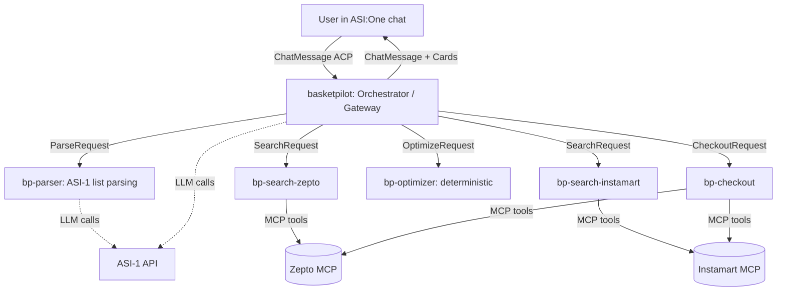

# BasketPilot


> An autonomous, multi-agent grocery copilot for Indian quick commerce. Give it a messy 20-item list inside an ASI:One chat. It resolves every item across platforms, compares landed cost (items + all fees), proposes the cheapest cart split, collects your address, builds the carts on your own account, and places the order only after you approve it.

**Event:** Fetch.ai Innovation Lab "Stranger Builds" (Oct 31 to Nov 7, 2026), Challenge 1: *ASI:One Agent Challenge, From Intent to Action* (and aiming at Challenge 2, *Best Use of ASI:One*, see Decision D2).
**Hackpack:** https://innovationlab.fetch.ai/events/hackathons/stranger-builds-1/hackpack
**Platforms:** Zepto official MCP (primary, live) and Swiggy Instamart official MCP (access-gated, see Section 6). Where an official MCP lacks a capability, Codex builds a guarded fallback tool (Section 7.2).

---

## 0. How to use this document (read first, Codex)

This file is both the **project spec** and the **submission README**. Sections 1-18 are the spec you build against. Section 19 is the submission checklist. Section 20 lists open questions you must resolve by reading code or docs, not by guessing. Section 21 lists working rules for you.

If a statement in this file conflicts with the official hackpack or Fetch.ai docs, **the official docs win**. Flag the conflict in `docs/DECISIONS.md`.

---

## 1. Registered agents (fill in after deployment)

Judges need name and address in this README. Update this table the moment each agent is registered.

| Agent | Role | Agentverse address | Mailbox | ASI:One discoverable |
|---|---|---|---|---|
| `basketpilot` (Orchestrator / Gateway) | Only agent users talk to. Implements Agent Chat Protocol (ACP) | `agent1q...TODO` | yes | yes |
| `bp-parser` | Messy list -> structured items (ASI-1) | `agent1q...TODO` | optional | no |
| `bp-search-zepto` | Zepto adapter (official MCP) | `agent1q...TODO` | optional | no |
| `bp-search-instamart` | Swiggy Instamart adapter (official MCP, whitelist-gated; MockAdapter fallback if access is not granted) | `agent1q...TODO` | optional | no |
| `bp-optimizer` | Deterministic cost optimizer | `agent1q...TODO` | optional | no |
| `bp-checkout` | Address, cart build, preview, confirm, payment | `agent1q...TODO` | optional | no |

Extra resources required to run: see Section 14 (env vars) and Section 15 (setup).

---

## 2. Problem and solution

**Problem.** A 20-item quick-commerce order means opening 2-3 apps, searching each item in each app, comparing prices by eye (pack sizes differ), ignoring handling/delivery/late-night fees that appear only at checkout, and re-entering addresses. It takes 15-30 minutes and users usually just pick one app and overpay.

**Solution.** BasketPilot is an agent system, not a chatbot wrapper. It plans and executes a multi-step workflow with real tools (quick-commerce MCP servers), pauses for the user only where judgment or money is involved.

**One-line pitch for judges:** *"From a pasted shopping list to a cost-optimised, ready-to-pay cart across platforms, entirely inside an ASI:One conversation."*

---

## 3. Hackathon rules compliance (source: hackpack)

### 3.1 Mandatory (eligibility gates, every one must be demonstrably true)

| # | Requirement | How BasketPilot satisfies it | Status |
|---|---|---|---|
| M1 | Register at least one agent on Agentverse | Orchestrator runs as a **mailbox agent** connected to Agentverse; workers optionally registered too | TODO |
| M2 | Implement the Agent Chat Protocol (ACP) | `chat_protocol_spec` on the Orchestrator, with `ChatMessage` + `ChatAcknowledgement` handlers, `publish_manifest=True` | TODO |
| M3 | Discoverable and usable through ASI:One | Good agent README + description + tags on Agentverse; test by finding it from asi1.ai chat | TODO |
| M4 | Meaningful tool execution or multi-agent orchestration | MCP tool calls to quick-commerce platforms + 5 cooperating agents | TODO |
| M5 | Primary workflow completes entirely inside an ASI:One conversation, no custom frontend | List -> address -> comparison -> plan -> preview -> confirm all via chat (+ interactive cards) | TODO |
| M6 | Public GitHub repo with run/test instructions | This repo; Section 15-16 | TODO |

### 3.2 Bonus points (target as many as time allows, in this order)

1. **Effective multi-agent collaboration**: real message passing between specialist agents (Section 5), not one process pretending.
2. **Reliability, error handling, recovery from failed tool calls**: Section 12. This is a core strength of the existing feature set (retries, store notices, OAuth re-auth).
3. **ASI Interactive Cards**: forms (address picker), carousels (item matches), review screen (cart plan), confirm button. Docs: https://innovationlab.fetch.ai/resources/docs/interactive-cards/asi-interactive-cards
4. **Creative use of real-time data**: live prices, live availability, live fees.
5. **Could realistically continue after the hackathon**: Section 17 (roadmap) + monetisation note.
6. **Payment Protocol with a credible monetisation model**: stretch goal, Section 13.

### 3.3 Judging weights -> where we invest

| Criterion | Weight | Our lever |
|---|---|---|
| Functionality & technical implementation | 25% | Working end-to-end happy path; agents visibly communicating in logs/demo |
| Use of Fetch.ai technology | 20% | uAgents, Agentverse registration, ACP, ASI:One discovery, ASI-1 as the LLM, (stretch) Payment Protocol |
| Innovation & creativity | 20% | Cross-platform **fee-aware cart splitting** (not just price lookup) |
| Real-world impact & usefulness | 20% | Quantified savings and time saved shown in every plan |
| UX & presentation | 15% | Cards, clean tables, 3-5 min scripted demo |

### 3.4 Prizes (for motivation and scoping)
Public Choice Award $1000; Best Use of Fetch.ai $750; Best Use of ASI:One $500. Free month of ASI:One Pro + Agentverse Premium with the code on the hackpack page.

---

## 4. Architecture decisions (ADR summary)

**D1. Framework = uAgents for all agents.** The hackpack allows any framework, but uAgents gives the cleanest path to Agentverse, mailbox, ACP and the "Best Use of Fetch.ai" prize. Orchestration logic inside an agent can still be plain Python; do **not** pull LangChain/LangGraph into the runtime path.

**D2. ASI-1 is the only LLM.** Challenge 2 ("Best Use of ASI:One") says *no other LLMs allowed*. Since the same project can compete in both challenges, every LLM call (list parsing, match re-ranking, substitution reasoning, natural-language summaries) goes through the ASI:One API. The earlier prototype used LangChain/LangGraph with other LLM APIs: **remove those LLM dependencies**. Keep it clean: one `llm.py` module wraps ASI-1; nothing else imports an LLM SDK.

**D3. LLM does language, code does math.** ASI-1 parses and ranks. All price arithmetic, fee calculation, and cart splitting are deterministic Python with unit tests. Never let the LLM compute totals.

**D4. Mailbox agent for the Orchestrator.** The agent runs on the builder's machine (where the MCP servers and the user's logged-in platform sessions live) and is reached via Agentverse mailbox, so no public endpoint or tunnel is needed.

**D5. Platform access behind an adapter interface.** Each platform MCP is wrapped by a `PlatformAdapter` (Section 7). Orchestration never calls MCP tools directly. If one MCP is flaky or unavailable, swap or mock without touching agents.

**D6. Autonomous up to the point of spending money.** The system plans and executes carts autonomously; `place_order` always requires an explicit user approval step in chat (two-step preview token -> confirm). This is a feature to highlight, not a limitation.

**D7. Single-tenant by design for the hackathon.** One user's platform sessions, one machine. Multi-user would require per-user auth vaulting and is explicitly roadmap (Section 18).

**D8. Official MCP servers first.** Zepto and Swiggy both publish official MCP servers (verified against their own docs/blog on Oct 31, 2026; Section 6). Both use **OAuth 2.1 with PKCE**: the user signs in on the platform's own page and the client receives a token, so the agent and the LLM never see the OTP or credentials. BasketPilot uses that flow. It does **not** pass OTPs through chat.

**D9. Capability gaps are filled by guarded fallback tools.** If an official MCP lacks something BasketPilot needs, Codex builds its own small tool for that specific gap behind the same adapter interface (Section 7.2), following a fixed order of preference and hard guardrails. Fallbacks are documented, flagged in the README, and never used to bypass authentication, the confirm gate, or platform controls.

---

## 5. System architecture



### 5.1 Agents and responsibilities

| Agent | Responsibility | LLM? | Talks to |
|---|---|---|---|
| **basketpilot** (Orchestrator) | ACP endpoint. Per-session state machine. Routes work, assembles replies and cards, enforces confirmation gates | ASI-1 for conversational phrasing and ambiguity questions | users, all workers |
| **bp-parser** | Raw text -> `ParsedList` (name, qty, unit, brand pref, constraints like "organic", "any brand") | ASI-1 (JSON output) | Orchestrator |
| **bp-search-\<platform\>** (one per platform) | `resolve_items` per platform (built on the platform's search tools), returns ranked candidates with normalised unit price, availability, ETA | ASI-1 optional for re-ranking ambiguous matches | Orchestrator, platform MCP |
| **bp-optimizer** | Fee-aware cart assignment and savings report | none | Orchestrator |
| **bp-checkout** | address handling, `add_to_cart` + validation, itemised bill, two-step order (our preview token, then platform checkout), payment (link / wallet / QR), OAuth session handling | none | Orchestrator, platform MCP |

Per-platform search agents run **in parallel** (async fan-out). This is what delivers "search all platforms simultaneously" and is visible in logs.

### 5.2 Process model
- Run everything in one process via a `uagents.Bureau` for development simplicity, or as separate processes if time allows. Inter-agent traffic must still use uAgents `Model` messages addressed by agent address, so it is genuine multi-agent communication either way.
- Only the Orchestrator needs mailbox + ACP. Workers may stay local. Registering workers on Agentverse is optional polish (and helps "multi-agent" optics).

### 5.3 Session state (Orchestrator)
Keyed by the ASI:One `sender` address / session id. Fields:

```python
class Session:
    state: Literal["IDLE","COLLECTING_LIST","NEED_ADDRESS","SEARCHING",
                   "REVIEW_MATCHES","PLAN_READY","CART_BUILDING",
                   "PREVIEW_READY","AWAITING_CONFIRM","PLACED","FAILED"]
    raw_list: str
    items: list[ParsedItem]
    address: AddressChoice | None
    platform_results: dict[str, list[ItemCandidates]]
    plan: CartPlan | None
    preview_tokens: dict[str, str]   # platform -> token bound to cart hash
    created_at: datetime
    last_active: datetime
```
Persist to a local JSON/SQLite store so a restart mid-demo does not lose the session. Expire sessions after N minutes (default 60). **Never persist OTPs, CVV, card data.**

### 5.4 Inter-agent message models (uAgents `Model`)

```python
class ParseRequest(Model):  session_id: str; text: str
class ParsedItem(Model):    id: str; name: str; qty: float; unit: str | None; brand: str | None; notes: str | None
class ParsedList(Model):    session_id: str; items: list[ParsedItem]; ambiguities: list[str]

class SearchRequest(Model): session_id: str; items: list[ParsedItem]; address_id: str | None
class Candidate(Model):
    sku_id: str; title: str; brand: str | None; pack_size: str
    price: float; mrp: float | None; unit_price: float | None   # normalised e.g. per 100 g / per L
    in_stock: bool; max_qty: int | None; eta_min: int | None; match_score: float
class ItemCandidates(Model): item_id: str; candidates: list[Candidate]
class SearchResult(Model):  session_id: str; platform: str; results: list[ItemCandidates]
                            store_status: Literal["OK","CLOSED","UNSERVICEABLE","NEEDS_ADDRESS","NEEDS_LOGIN"]; notice: str | None

class OptimizeRequest(Model): session_id: str; items: list[ParsedItem]; results: list[SearchResult]; fee_schedules: dict
class CartPlan(Model):
    assignments: list[Assignment]       # item -> platform, sku, qty, line price
    per_platform: dict                  # subtotal, fees (itemised), total
    grand_total: float
    baselines: dict                     # best_single_platform, naive_cheapest_per_item
    savings_vs_best_single: float
    unfulfilled: list[str]
    rationale: list[str]

class CheckoutRequest(Model): session_id: str; platform: str; assignments: list[Assignment]; address_id: str
class CheckoutPreview(Model): session_id: str; platform: str; bill: ItemisedBill; preview_token: str; warnings: list[str]
class ConfirmRequest(Model):  session_id: str; platform: str; preview_token: str
class OrderResult(Model):     session_id: str; platform: str; status: str; order_ref: str | None; payment_qr_path: str | None; error: str | None
```
Field names above are the intended contract; adjust types freely but keep the message boundaries.

---

## 6. Platforms, capabilities and tool mapping

### 6.1 Verified facts (sources fetched Oct 31, 2026)

| | Zepto | Swiggy Instamart |
|---|---|---|
| Official MCP | Yes. Zepto's own MCP server. Setup/docs: `github.com/zeptonow/mcp`. Engineering blog: "How Zepto Enables Seamless Shopping through AI" (blog.zepto.com) | Yes. Swiggy Builders Club exposes 4 **independent** servers (Food, Instamart, Dineout, Scenes). Instamart = `mcp.swiggy.com/im`, **19 tools**. Docs: `mcp.swiggy.com/builders` |
| Auth | OAuth 2.1 with mandatory PKCE. User logs in (phone + OTP) on Zepto's own page; the MCP client gets a token. Zepto moved away from `send_otp`/`verify_otp` tools because the OTP ended up in the model's context | OAuth 2.1 with PKCE, session auth, no credentials as tool arguments |
| Transport | per Zepto docs | Streamable HTTP, JSON-RPC, one URL per server |
| Tools named in sources | `search`, `add_to_cart`, `checkout` (initially COD), `get_user_preferences` (blog; the list may have grown, introspect) | 19 tools, listed in Swiggy's Reference docs (introspect) |
| Payment options (Zepto blog) | COD; short-lived **payment links**; **Zepto Cash**; **UPI Reserve Pay** (user pre-authorises a limit, agent can then pay within it without per-order confirmation) | per Swiggy docs |
| Access | per Zepto docs | **Invite-based / whitelisted for production, partner contract.** A consumer path exists (config paste into an AI client such as Claude Desktop). Apply at `mcp.swiggy.com/builders/access` |
| Carts / sessions | per Zepto docs | Each Swiggy server has its own carts, orders and sessions |

Not verified by us: anything on third-party pages (ecommerceguide, trucommerce, the community `quick-commerce-mcp` repo). Treat them as leads, not facts.

### 6.2 Capability matrix

The method names in the left column (`resolve_items`, `list_addresses`, `select_address`) are **BasketPilot adapter methods**. They came from the earlier prototype and may not exist as tools on the official servers. For each one, Codex maps it to the real tool(s) found by introspection, or builds a fallback (Section 7.2).

| Capability (adapter method) | Used for | Official MCP source (introspect to confirm) | If missing |
|---|---|---|---|
| Search / item resolution (`resolve_items`) | Multi-platform search, ranking matches per platform | Zepto `search`; Instamart search/catalog tools | Compose from available search tools; ASI-1 + deterministic scoring does the ranking |
| Personalised search | Brand preferences | Zepto `get_user_preferences` | Skip; ask the user for brand constraints in chat |
| Addresses (`list_addresses` / `select_address`) | Ask for address, use the user's account | Unknown: check both servers | Ask the user to pick/type an address in chat; fallback tool if the platform needs one set before search works |
| Store notices | Closed / unserviceable / "add address to proceed" | Tool errors and result flags | Parse error taxonomy (Swiggy publishes canonical error codes) into the shared `store_status` enum |
| Cart add + validation (`add_to_cart`) | Build carts, verify items, quantities, bill total | Zepto `add_to_cart`; Instamart cart tools | Re-read cart after add and diff against intent (this is our own validation either way) |
| Itemised bill | Handling, late-night, GST, delivery, other fees listed separately | Cart/checkout response, if it exposes fees | Local bill parser; if fees are not exposed, mark the plan "fees estimated" |
| Preview before order | User sees the exact bill before spending | **Not a native step.** Build from the cart snapshot | Always our own construct (Section 7) |
| Place order (`place_order`) | Final purchase | Zepto `checkout`; Instamart checkout tool | n/a: if absent, stop at preview and hand the user a deep link |
| Payment | Pay for the order | Zepto: payment link, Zepto Cash, COD, UPI Reserve Pay | Payment link first; local QR renderer for a link if useful |
| Auth / session | Use the user's own account | OAuth 2.1 + PKCE on both | Local OAuth helper (Section 7.2). No OTP through chat |

### 6.3 Feature list (product behaviour)

| Feature | Behaviour | Owner agent |
|---|---|---|
| Multi-platform search | Find products across all platforms simultaneously (parallel fan-out) | search agents |
| Item resolution | Ranks matches **per platform** for each requested item | search agents |
| Price comparison | Best deal per item and in total, normalised unit prices | optimizer |
| Smart cart | Suggests the optimal platform split, fee-aware | optimizer |
| Cart validation | After adding, validates items, quantities and bill total | checkout |
| Itemised bill | Handling, late-night, GST and other fees listed **separately** in cart and order preview | checkout |
| Addresses | Asks for the address; uses the user's saved addresses where the platform exposes them | checkout + orchestrator |
| Store notices | Closed/unserviceable stores and "Add address to proceed" detected and reported with next steps | search + checkout |
| User control | Two-step order: our preview token, then explicit user confirm, then platform checkout | checkout + orchestrator |
| Payment | Payment link / Zepto Cash / COD as the platform allows. UPI Reserve Pay is **off** for the demo (Section 11) | checkout |
| Session handling | OAuth login link when a token is missing or expired; automatic resume | checkout + orchestrator |

Items from the old prototype that are **dropped** for the official servers unless a fallback is justified: CVV from `QC_CVV_<last4>`, OTP prompted in chat, UPI QR cropping.

---

## 7. Platform adapter contract

Every platform wrapper implements this interface. Agents depend only on it.

```python
class Capability(str, Enum):
    SEARCH = "search"; PERSONALISATION = "personalisation"
    LIST_ADDRESSES = "list_addresses"; SELECT_ADDRESS = "select_address"
    ADD_TO_CART = "add_to_cart"; CART_SNAPSHOT = "cart_snapshot"; FEE_BREAKDOWN = "fee_breakdown"
    PLACE_ORDER = "place_order"; PAYMENT_LINK = "payment_link"; WALLET_PAY = "wallet_pay"; CLEAR_CART = "clear_cart"

class PlatformAdapter(Protocol):
    name: str                                            # "zepto", "instamart", ...
    capabilities: set[Capability]                        # discovered from list_tools at startup + registered fallbacks
    async def ensure_auth(self) -> AuthStatus            # OK | NEEDS_LOGIN (token missing/expired and refresh failed)
    async def begin_login(self) -> LoginInstructions     # OAuth authorization URL + how it completes (local callback)
    async def list_addresses(self) -> list[Address]      # may be a fallback (ask user)
    async def select_address(self, address_id: str) -> StoreStatus   # OK / CLOSED / UNSERVICEABLE / NEEDS_ADDRESS
    async def resolve_items(self, items: list[ParsedItem]) -> list[ItemCandidates]
    async def add_to_cart(self, lines: list[CartLine]) -> CartSnapshot  # includes validation result + bill
    async def get_fee_schedule(self) -> FeeSchedule      # delivery, handling, small-cart, free-delivery threshold, late-night, min order
    async def preview_order(self) -> CheckoutPreview     # built from the cart snapshot; returns OUR preview_token
    async def place_order(self, preview_token: str, payment: PaymentChoice) -> OrderResult
    async def clear_cart(self) -> None
```

**Critical:** the official `checkout` tools can place an order directly (Zepto's started as COD checkout). There is no native "preview then confirm" step, so `preview_order` is **BasketPilot's own construct**: it reads the cart snapshot, computes the bill, and issues a token bound to the cart hash. `place_order` calls the platform's `checkout` **only after** the token is valid and the user has explicitly confirmed. No code path may call the platform `checkout` tool any other way. Add a test that enforces this.

### 7.1 Implementation notes
- **Normalise everything at the adapter boundary** (currency to float rupees, units to a canonical form, platform-specific store states and error codes to the shared enum). Nothing platform-specific leaks upward.
- Provide a `MockAdapter` with fixture data from day 1. It unblocks parallel development, unit tests, and the demo fallback if a live platform breaks or Instamart access is not granted.
- MCP client: use the official Python `mcp` SDK, which supports OAuth 2.1 client auth and streamable HTTP. Wrap every call with timeout, bounded retry, and structured logging (redact secrets).
- **OAuth in a headless agent:** `begin_login` returns the platform's authorization URL. The user opens it, signs in on the platform's own page, and the redirect lands on a local callback served by the adapter's OAuth helper. This works because the demo is single-tenant on the builder's machine (D7). Tokens are stored locally (OS keyring or a `chmod 600` file), refreshed automatically, never logged, never sent to ASI-1 or into chat.
- Do not assume tool names. **Introspect each MCP server's `list_tools` output at startup**, map tools to `Capability`, and record real schemas in `docs/MCP_TOOLS.md`. Log the resulting capability matrix.

### 7.2 Capability gaps: guarded fallback tools (Codex builds these)

If a capability the product needs (Section 6.2) is not available from the official MCP, Codex creates its own tool for that specific gap so the agent still works. Preferred order, stop at the first that works:

1. **Compose** from existing official tools (for example, derive serviceability from search errors; re-read the cart to validate it).
2. **Ask the user in chat** (for example, the user types or picks the delivery address or pincode).
3. **Build a small local helper** (for example, the local OAuth callback helper, a bill/fee parser, a payment-link-to-QR renderer, a unit-price normaliser).
4. **Browser automation (Playwright)** only as a last resort for a missing read/assist capability. Mark it **experimental**.

Guardrails (hard rules):
- Fallback tools live in `basketpilot/platforms/fallback/`, implement the same adapter method, register a `Capability`, and are individually switchable via `BP_FALLBACK_TOOLS_ENABLED`.
- **Own account only.** Never bypass, spoof or circumvent authentication, OTP/anti-bot controls, rate limits, or platform terms. If a platform requires OTP and offers no OAuth, the OTP is entered in the **local terminal** by the user (`local_otp_prompt()`); it never enters ASI:One chat, logs, session state, or any LLM context.
- Fallbacks never reach the order-placing step except through the normal confirm gate (Section 7 critical note).
- Each fallback gets an entry in `docs/FALLBACKS.md`: the gap, why the official MCP could not cover it, the approach, and the risk. The README "Known limitations" section lists them.
- The demo video must not present a fallback as an official platform feature.
- Low request rate, polite delays, no bulk scraping.

---

## 8. Optimization engine (the differentiator)

### 8.1 Inputs
For each item: candidate offers per platform (price, pack size, unit price, stock, max qty). For each platform: fee schedule and store status.

### 8.2 Objective
Minimise **landed total** = sum(line prices) + sum over used platforms of (delivery + handling + small-cart + late-night fees + other fees; GST as shown) with a small configurable penalty per additional platform (extra order = extra hassle and delivery time) and optional ETA penalty.

### 8.3 Algorithm (deterministic, explainable)
1. **Normalise** offers to comparable units (per 100 g / per L / per piece). Choose the candidate pack that satisfies the requested quantity at the lowest total, respecting `max_qty`. Prefer exact brand if specified, else best `match_score`/price tradeoff.
2. **Enumerate platform subsets** S (there are at most 2^P - 1 with P <= 3-4).
3. For each S: assign every item to its cheapest available offer within S; compute per-platform fees from fee schedules; check minimum order values.
4. **Free-delivery threshold repair**: if a platform total is just below its free-delivery/small-cart threshold, try (a) moving items to it from another platform if net cost drops, (b) suggest a cheap filler item. Bounded local search; stop when no improving move.
5. **Pick the minimum-cost feasible S.** Also compute baselines: best *single-platform* plan, and naive cheapest-per-item ignoring fees. Report both savings numbers.
6. Items unavailable everywhere go into `unfulfilled` with substitution suggestions (ASI-1 may propose substitutes; the optimizer re-prices them).
7. Produce `rationale`: short, human-readable reasons ("Moved milk to Zepto to cross free-delivery threshold, net saving Rs 18").

Stretch: model the same as an ILP/CP-SAT problem (OR-Tools) to prove optimality. Only after the heuristic is tested and demo-ready.

### 8.4 Tests (required)
Property/unit tests with fixtures: single platform only; one platform closed; item unavailable everywhere; threshold edge cases (just below/above free delivery); tie-breaking determinism; unit-price normalisation; split never costs more than the best single-platform plan **unless** the penalty term justifies it.

---

## 9. Conversation and UX design (inside ASI:One only)

No custom frontend. Everything goes through ACP `ChatMessage`s, enhanced with ASI Interactive Cards where supported, with plain-text/markdown fallbacks always available.

### 9.1 Happy-path flow
1. **User:** pastes list ("2L milk, 1kg onions, eggs x12, ...").
2. **Orchestrator -> parser:** structured items. If ambiguous ("rice"?), ask **one batched** clarification, not item-by-item.
3. **Address gate:** if no address is selected, list saved addresses where the platform exposes them (card: address picker); otherwise ask the user to type one. If a store is unserviceable for that address, say so and offer alternatives.
4. **Auth gate:** if a platform's OAuth token is missing or expired, send that platform's login link. The user signs in on the platform's own page; the agent never sees credentials or an OTP. Resume automatically once the token arrives.
5. **Fan-out search** (parallel), progress message: "Searching Zepto and Instamart..."
6. **Match review (only for low-confidence items):** card carousel of top candidates; default auto-picks high-confidence matches.
7. **Plan:** table of item -> platform -> price; per-platform itemised fees; grand total; savings vs best single platform and vs naive. Buttons: *Approve plan* / *Prefer single platform* / *Swap an item*.
8. **Cart build** on each platform via `add_to_cart` with validation; surface any mismatch immediately.
9. **Preview:** itemised bill per platform (items, handling, late-night, GST, delivery, total) + preview token held server-side.
10. **Confirm:** explicit button/text "Confirm & place order (Zepto)". Only then call `place_order` with the chosen payment method (prefer a payment link or Zepto Cash). Return the order reference or the payment link.
11. **Summary:** total spent, total saved, time taken.

### 9.2 Rules
- Never place an order from an ambiguous message. Require the explicit confirm action bound to the current preview token.
- Keep messages short; tables for comparisons; one question at a time (batch only for list ambiguities).
- If cards are not rendered, fall back to numbered options the user can answer with a number.
- Always handle ACP `StartSessionContent` / `EndSessionContent` and send `ChatAcknowledgement` for every received message.
- Long operations: send intermediate progress messages so the chat never looks frozen.

### 9.3 Agent discoverability metadata
Write the Agentverse agent README so ASI:One routes to it: name, one-sentence capability, example prompts ("Compare prices for my grocery list across Zepto and Swiggy Instamart and place the cheapest order"), supported platforms, and the two badges at the top of this file.

---

## 10. ASI-1 usage

- Base URL, auth header and model id: **read** https://innovationlab.fetch.ai/resources/docs/asione/asi-one-quickstart (the API is OpenAI-compatible as far as I know, but do not hardcode from memory).
- `llm.py` exposes small typed functions: `parse_list(text) -> ParsedList`, `rerank_matches(item, candidates) -> ranked`, `suggest_substitutes(item, context) -> list`, `explain_plan(plan) -> str`.
- Force JSON output with schema validation (pydantic). On invalid JSON: one repair retry, then fall back to a deterministic regex parser for the list (so the demo never dies on LLM formatting).
- Keep prompts in `prompts/` as versioned files. Add 10+ messy real-world list fixtures (Hinglish, typos, quantities like "1/2 kg", "dozen") to `tests/fixtures/lists.json`.
- Cache identical LLM calls in dev to save quota and speed up iteration.
- Make the ASI-1 role obvious in the demo: it is the parser, ranker and negotiator of ambiguity. This is what "core engine, not a side feature" means for Challenge 2.

---

## 11. Security, privacy, and safety

Money and credentials are involved. Treat this as a first-class section.

1. **No autonomous spending.** `place_order` requires preview token + explicit user confirm. Token is bound to a hash of (platform, items, quantities, bill total, address) and expires in minutes. If the cart changes, the token is invalid.
2. **Secrets.** OAuth tokens, API keys and seed phrases are never logged, never echoed to chat, never stored in session state, never sent to ASI-1. Tokens live in the OS keyring or a `chmod 600` file. No card data or CVV passes through the agent. Add a log-redaction filter and a test asserting no secret patterns appear in logs.
3. **Authentication.** Official MCPs use OAuth 2.1 + PKCE: the user signs in on the platform's own page, so the agent and the LLM never see the OTP or password (this is why Zepto moved away from OTP-through-chat). **Never accept an OTP in the ASI:One chat.** If a fallback tool ever needs one, it is entered in the local terminal only (Section 7.2).
4. **Hosted/multi-user is out of scope.** Do not collect other people's card data or credentials in chat. Say so in the README.
5. **Own-account use and platform terms.** The demo uses the builder's own accounts through official MCP servers. Swiggy's production access is whitelisted under a partner contract: do not represent a demo as a production integration. Browser-automation fallbacks may breach platform terms, so keep them experimental, low-rate, and clearly disclosed.
6. **Prompt-injection hygiene.** Product titles and store notices are untrusted text. Never feed them into prompts as instructions; pass as quoted data with a system instruction to ignore embedded commands. Tool calls are decided by code paths, not by free text from platforms.
7. **Rate limiting / abuse.** Basic per-session rate limit and max-items cap (e.g. 60) on the Orchestrator.
8. **Payments.** Prefer a payment link or Zepto Cash; no payment credentials flow through the agent. **Do not enable UPI Reserve Pay (autonomous payment within a preset limit) for the demo**; if ever enabled, keep the limit low and keep our confirm gate in front of it anyway. A generated link or QR is not payment success: only report "paid/placed" when the platform's confirmation is observed.
9. **Fallback tools** follow the guardrails in Section 7.2.

---

## 12. Reliability and error handling (explicit bonus criterion, make it demonstrable)

| Failure | Detection | Recovery | User-visible message |
|---|---|---|---|
| OAuth token expired | adapter returns `NEEDS_LOGIN` after a failed refresh | Try the refresh token; else send the platform login link, resume the interrupted step after sign-in | "Zepto login expired. Open this link to sign in again." |
| Platform access denied (e.g. Instamart not whitelisted) | 401/403 at connect | Exclude the platform, plan with the rest, label the demo honestly | "Instamart is not available for this account; planned with Zepto only." |
| Store closed | `store_status=CLOSED` | Exclude platform, re-plan with the rest | "Zepto is closed at this address; planned with <others>." |
| Unserviceable / no address | `UNSERVICEABLE` / `NEEDS_ADDRESS` | Prompt address selection, retry | "Add or select an address to proceed." |
| Address not accepted / selection not reflected | verify after `select_address` | Retry once, then ask the user for the address again | (silent unless it fails twice) |
| MCP tool timeout | timeout | bounded retry with backoff, then degrade | "Instamart is slow; continuing without it." |
| Cart mismatch after add | `add_to_cart` validation fails | re-add once; if still wrong, show diff, ask user | "Cart shows 1 onion pack, expected 2." |
| Price/bill drift between plan and preview | preview total != plan | re-run optimizer on fresh data; show change | "Prices moved by Rs X; here is the updated plan." |
| Item unavailable | no in-stock candidates | ASI-1 substitutes, re-price | "Out of stock; suggest <X>?" |
| LLM invalid output | schema validation | one repair retry, then deterministic fallback | (silent) |
| Partial success (split order) | one platform fails | keep the successful one, offer re-plan of the remainder | clear per-platform status |

Idempotency: every state-changing step (add_to_cart, place_order) must be safe to retry or must check current state first. A double-placed order is the worst possible bug.

Add a `--chaos` flag in the `MockAdapter` to inject these failures for tests and for a live "recovery" moment in the demo.

---

## 13. Payment Protocol (stretch, bonus)

Hackpack bonus: *"Implementation of the Payment Protocol with a credible monetization model."* Verify the current spec in Fetch.ai docs before designing (do not assume the API).

Candidate model: a small fee per optimised order, or "pay only if savings exceed X" (charge a fraction of verified savings). Gate it behind a flag (`BP_ENABLE_PAYMENT_PROTOCOL`) so the core demo never depends on it. Only attempt after M1-M6 and the reliability work are green.

---

## 14. Configuration (env vars)

```bash
# Fetch.ai / Agentverse
AGENTVERSE_API_KEY=            # from agentverse.ai
ORCHESTRATOR_SEED_PHRASE=      # stable seed => stable agent address; keep secret, never commit
WORKER_SEED_PHRASES_JSON=      # {"parser":"...","search_zepto":"...", ...}

# ASI-1
ASI1_API_KEY=
ASI1_BASE_URL=                 # per quickstart docs
ASI1_MODEL=                    # per quickstart docs

# Platforms (official MCP servers; OAuth 2.1 + PKCE, no passwords/OTPs in config)
ZEPTO_MCP_URL=                 # per github.com/zeptonow/mcp
INSTAMART_MCP_URL=https://mcp.swiggy.com/im   # per Swiggy Builders docs; access is whitelisted
OAUTH_CALLBACK_PORT=8765       # local callback for the one-time login
TOKEN_STORE=keyring            # keyring | file (chmod 600)

# Behaviour
BP_FALLBACK_TOOLS_ENABLED=true # guarded fallback tools (Section 7.2); individually switchable
BP_MAX_ITEMS=60
BP_SESSION_TTL_MIN=60
BP_MULTI_PLATFORM_PENALTY=10   # rupees added per extra platform in objective
BP_USE_MOCK=false              # true => MockAdapter everywhere
BP_ENABLE_PAYMENT_PROTOCOL=false
```
`.env.example` must be committed; `.env` must be git-ignored. Add a pre-commit secret scan.

---

## 15. Setup and run

```bash
git clone <this-repo> && cd basketpilot
python -m venv .venv && source .venv/bin/activate
pip install -r requirements.txt        # uagents, uagents-core, mcp, pydantic, httpx, openai-compatible client or httpx, pytest
cp .env.example .env                   # fill in keys

# One-time platform login (opens the platform's own OAuth page; tokens are stored locally)
python -m basketpilot.auth zepto
python -m basketpilot.auth instamart   # only if Swiggy access was granted

# 1. Dev without live platforms
BP_USE_MOCK=true python -m basketpilot.run

# 2. Live
python -m basketpilot.run
```

### 15.1 Connect the Orchestrator to Agentverse (mailbox)
1. Create the Orchestrator with `Agent(name="basketpilot", seed=ORCHESTRATOR_SEED_PHRASE, mailbox=True)` (see the mailbox section of https://innovationlab.fetch.ai/resources/docs/agent-creation/uagent-creation).
2. Start it. The logs print an **Agent Inspector** link. Open it, choose **Connect -> Mailbox**, and complete the flow with your Agentverse account.
3. Include the chat protocol: `agent.include(chat_proto, publish_manifest=True)`.
4. In Agentverse, open the agent, paste the README/description (with the two badges), and add tags.
5. Copy the agent address into Section 1 of this README.
6. Open https://asi1.ai/chat, find the agent via a natural-language query (and/or "Agents" selection), and run the full flow. **Do this on day 1 with an echo handler**, not on the last day.

> **Warning about the hackpack quick-start snippet:** it is incomplete as published (missing imports for `Agent`, `Protocol`, `Context`; broken indentation; a `fund_agent_if_low` import that is not needed for mailbox agents). Use it as a shape reference only. Build from the "How to create ASI:One compatible uAgents" guide: https://innovationlab.fetch.ai/resources/docs/examples/chat-protocol/asi-compatible-uagents

### 15.2 Run the worker agents
Either via the same `Bureau` or separate processes (`python -m basketpilot.agents.optimizer`, etc.). Addresses derive from seed phrases, so they are stable across restarts; load them from config, do not hardcode.

---

## 16. Testing

| Layer | What | Tool |
|---|---|---|
| Unit | optimizer, unit normalisation, fee math, token binding, redaction | pytest |
| Contract | each adapter against recorded fixtures; `MockAdapter` implements the full interface | pytest |
| Agent | message round-trips between agents on a local Bureau | pytest-asyncio |
| LLM | parse fixtures (Hinglish, typos, fractions) -> schema-valid output | pytest with cached responses |
| E2E (mock) | scripted chat session from list to confirm | pytest |
| E2E (live) | manual checklist, run before recording the video | `docs/LIVE_CHECKLIST.md` |

Definition of done for any feature: unit tests + mock E2E pass + manual ASI:One run.

---

## 17. Repository layout

```
basketpilot/
  README.md                     # this file
  AGENTS.md                     # copy of Section 21 for Codex
  pyproject.toml / requirements.txt
  .env.example
  docs/
    DECISIONS.md                # ADR log, append-only
    MCP_TOOLS.md                # real MCP tool schemas discovered by introspection
    FALLBACKS.md                # every fallback tool: gap, reason, approach, risk
    LIVE_CHECKLIST.md
    demo_script.md
  basketpilot/
    run.py                      # Bureau / process entry
    config.py
    llm.py                      # ONLY place that talks to ASI-1
    models.py                   # all uAgents Model messages
    session.py                  # state machine + store
    cards.py                    # ASI interactive card builders + text fallbacks
    agents/
      orchestrator.py           # mailbox + ACP
      parser.py
      search.py                 # generic search agent parametrised by adapter
      optimizer.py
      checkout.py
    optimizer/
      normalize.py
      fees.py
      solve.py
    platforms/
      base.py                   # PlatformAdapter protocol
      zepto.py
      instamart.py
      mock.py                   # fixtures + chaos mode
      fallback/                 # guarded fallback tools (Section 7.2), each documented in docs/FALLBACKS.md
    auth/
      oauth.py                  # OAuth 2.1 + PKCE login helper, local callback, token store + refresh
    security/
      redact.py
      tokens.py
  prompts/
    parse_list.md
    rerank.md
    substitute.md
  tests/
    fixtures/
```

---

## 18. Build plan (Oct 31 to Nov 7) with cut lines

The hackathon runs Oct 31 to Nov 7, 2026. **The exact submission cutoff time is not stated on the hackpack page: confirm it on Discord / the submission agent today.** Plan to be submission-ready by **Nov 6** and treat Nov 7 as buffer.

| Day | Goal | Exit criterion |
|---|---|---|
| **Oct 31** | De-risk the platform. Skeleton repo, Orchestrator as mailbox agent with ACP echo, registered on Agentverse, reachable from ASI:One. **Also:** apply for Swiggy Builders access (`mcp.swiggy.com/builders/access`); OAuth smoke test against Zepto's MCP | You type in asi1.ai and your agent answers; Zepto `list_tools` returns over an authenticated session |
| **Nov 1** | `PlatformAdapter` + `MockAdapter`; OAuth helper + token store; introspect real MCPs, write `MCP_TOOLS.md` and the capability matrix; Zepto `resolve_items` live | One item resolved live end-to-end through an agent |
| **Nov 2** | ASI-1 `parse_list`; second platform (Instamart if access granted, else MockAdapter, labeled); parallel fan-out; address flow (platform tools or ask-the-user fallback) | 20-item list -> candidates from 2 platforms |
| **Nov 3** | Optimizer + tests; plan rendering (table + savings) | Plan with itemised fees and savings in chat |
| **Nov 4** | Checkout: `add_to_cart` validation, itemised preview from the cart snapshot, two-step `place_order` (our token, then platform `checkout`), payment link, OAuth re-login flow | Preview token flow works; stops safely before spending |
| **Nov 5** | Interactive cards; error recovery matrix; chaos tests | Failure scenarios from Section 12 demonstrated |
| **Nov 6** | README final, badges, addresses, demo video (3-5 min), submission via the Stranger Builds ASI:One Submission Agent | Submitted |
| **Nov 7** | Buffer. Payment Protocol only if everything above is green | n/a |

**Cut lines (drop in this order if behind):** Payment Protocol -> third platform -> ILP solver -> interactive cards for swaps (keep address + confirm cards) -> experimental Playwright fallbacks. **Never cut:** ACP, Agentverse registration, ASI:One end-to-end run, optimizer tests, confirm gate, README with addresses.

Post-hackathon roadmap (mention in README for the "could continue operating" criterion): multi-user auth vault, recurring lists ("weekly staples"), price-drop watching, more platforms, substitution learning, payment protocol monetisation.

---

## 19. Submission checklist

- [ ] At least one agent registered on Agentverse; address recorded in Section 1
- [ ] ACP implemented (`ChatMessage`, `ChatAcknowledgement`, session start/end handled)
- [ ] Agent found and used from asi1.ai chat; full primary workflow completes in that chat
- [ ] Meaningful tool execution (MCP) and multi-agent messaging visible
- [ ] Public GitHub repo; Sections 15-16 let a judge run or test it (mock mode works with zero credentials)
- [ ] README includes agent names + addresses, extra resources, and **both badges** (top of file)
- [ ] All agents categorised under Innovation Lab (badges also in each Agentverse agent README)
- [ ] Demo video, **3-5 minutes**, shows the agents working
- [ ] Registered via the Stranger Builds ASI:One Submission Agent (video + doc linked on the hackpack)
- [ ] If competing in Challenge 2: ASI-1 is the only LLM in the codebase (grep for other LLM SDK imports)
- [ ] No secrets in repo history

### Demo script (target 4:00)
1. (0:00) The problem in one sentence, show 3 apps vs one chat.
2. (0:25) Paste a messy 20-item list into ASI:One; agent is discovered and invoked.
3. (0:50) Address card; pick address. Show parallel search logs (multi-agent).
4. (1:30) Plan: per-platform split, itemised fees, "saves Rs X vs best single app".
5. (2:15) Inject a failure (store closed / session expired): agent recovers.
6. (2:50) Cart built and validated; itemised preview.
7. (3:20) Explicit confirm gate; stop at preview/QR (or place a small real order if you are comfortable).
8. (3:45) Architecture slide: uAgents + Agentverse + ACP + ASI-1; roadmap.

---

## 20. Open questions (resolve by inspection, do not guess)

1. Zepto MCP: endpoint URL, the full current tool list and schemas (`github.com/zeptonow/mcp`), and whether its OAuth accepts a `localhost` redirect for a headless client.
2. Swiggy Instamart MCP: the 19 tool names/schemas (Reference docs), whether a hackathon builder can get access in time (whitelist), and whether the consumer config-paste path works for a headless uAgent.
3. Do either of the official servers expose addresses (list/select) and fee breakdowns? If not, which Section 7.2 fallback applies?
4. Does the official `checkout` place an order immediately? (Assume yes. Section 7 critical note applies.)
5. ASI-1 API: base URL, model id, JSON-mode support, rate limits.
6. ASI Interactive Cards: exact schema, which components are supported, how they are returned inside ACP messages.
7. Payment Protocol: current spec and whether it fits a "pay per optimisation" model.
8. Submission cutoff time and whether judging expects a specific agent category/tag beyond the two badges.
9. Whether a real low-value order is acceptable in the demo (payment link / COD), or the demo stops at preview.

Record each answer in `docs/DECISIONS.md` with date and source.

---

## 21. Working rules for Codex (copy to AGENTS.md)

1. Read this README fully before writing code. Follow Sections 4-12 as the contract.
2. Work in small vertical slices. After each slice: run tests, run the mock E2E, commit.
3. **Do not invent** MCP tool names, ASI-1 endpoints, card schemas, or Payment Protocol APIs. Introspect or read the linked docs, then record findings in `docs/`.
4. No LLM SDK imports outside `llm.py`; only ASI-1 is allowed (Decision D2).
5. Never let the LLM do arithmetic. Totals come from `optimizer/` code with tests.
6. Never log or persist secrets (CVV, OTP, tokens, API keys). Use the redaction filter.
7. `place_order` must be unreachable without a valid, unexpired preview token bound to the current cart hash and an explicit user confirmation.
8. Every external call: timeout, bounded retry, structured error, and a user-safe message.
9. Keep `MockAdapter` at feature parity so the whole system runs with zero credentials.
10. When blocked or when a spec is ambiguous, write the question and your assumption in `docs/DECISIONS.md` and continue with the safest assumption.
11. Update Section 1 (agent addresses) and Section 19 as items are completed.
12. If an official MCP lacks a needed capability, build a guarded fallback tool per Section 7.2 (preference order, guardrails, `docs/FALLBACKS.md` entry). Never bypass authentication, OTP, anti-bot controls or platform terms.
13. Never accept or forward an OTP, password or card data through ASI:One chat, logs, or any LLM prompt. OAuth login happens on the platform's own page.
14. The platform `checkout` tool is only reachable through `place_order` after a valid preview token and explicit user confirmation. Keep the test that enforces this green.

---

## 22. References

- Hackpack: https://innovationlab.fetch.ai/events/hackathons/stranger-builds-1/hackpack
- Create a uAgent (incl. mailbox): https://innovationlab.fetch.ai/resources/docs/agent-creation/uagent-creation
- ASI:One-compatible uAgents (chat protocol): https://innovationlab.fetch.ai/resources/docs/examples/chat-protocol/asi-compatible-uagents
- uAgent <-> uAgent communication: https://innovationlab.fetch.ai/resources/docs/agent-communication/uagent-uagent-communication
- ASI:One API quickstart: https://innovationlab.fetch.ai/resources/docs/asione/asi-one-quickstart
- ASI Interactive Cards: https://innovationlab.fetch.ai/resources/docs/interactive-cards/asi-interactive-cards
- MCP integration with Fetch.ai: https://innovationlab.fetch.ai/resources/docs/mcp-integration/what-is-mcp
- Examples repo: https://github.com/fetchai/innovation-lab-examples
- Past hackathon projects (for inspiration): https://innovationlab.fetch.ai/projects
- Agentverse: https://agentverse.ai/ | ASI:One: https://asi1.ai/
- Swiggy Builders Club (MCP): https://mcp.swiggy.com/builders/ | What is Swiggy MCP: https://mcp.swiggy.com/builders/docs/start/what-is-swiggy-mcp/ | Access: https://mcp.swiggy.com/builders/access/
- Zepto MCP engineering blog: https://blog.zepto.com/how-zepto-enables-seamless-shopping-through-ai-fcc7d2e43c7b | Zepto MCP repo: github.com/zeptonow/mcp
- Model Context Protocol: https://modelcontextprotocol.io
